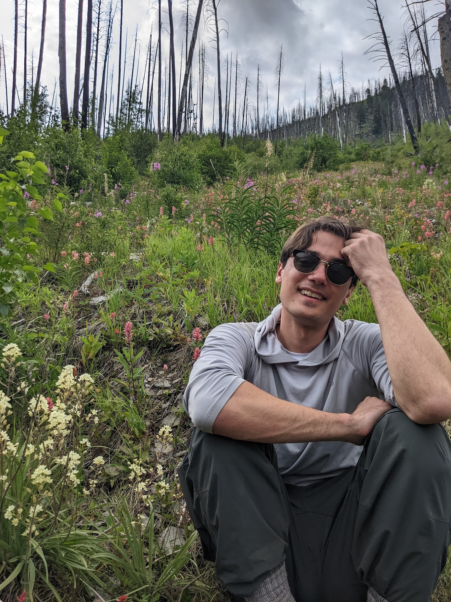

Hello! I'm currently a data scientist at <a href='https://www.antora.com' target='_blank'>Antora</a>, where I focus on optimizing dispatch decisions for <a href='https://www.nytimes.com/2026/10/29/climate/heat-battery-thermal-energy-storage.html' target='_blank'>really big thermal batteries</a>. I'm also on the core team of <a href="https://www.climatechange.ai" target="_blank">Climate Change AI</a>.

 Previously, I did data science and software at <a href='https://www.arcadia.com' target='_blank'>Arcadia</a>, a postdoc on machine learning for climate modeling with <a href='https://zanna-researchteam.github.io'>Laure Zanna</a> at NYU, a PhD on interpretable machine learning with <a href='https://finale.seas.harvard.edu' target='_blank'>Finale Doshi-Velez</a> at Harvard, and wrote software at <a href='https://www.vermonster.com' target='_blank'>Vermonster</a>.

